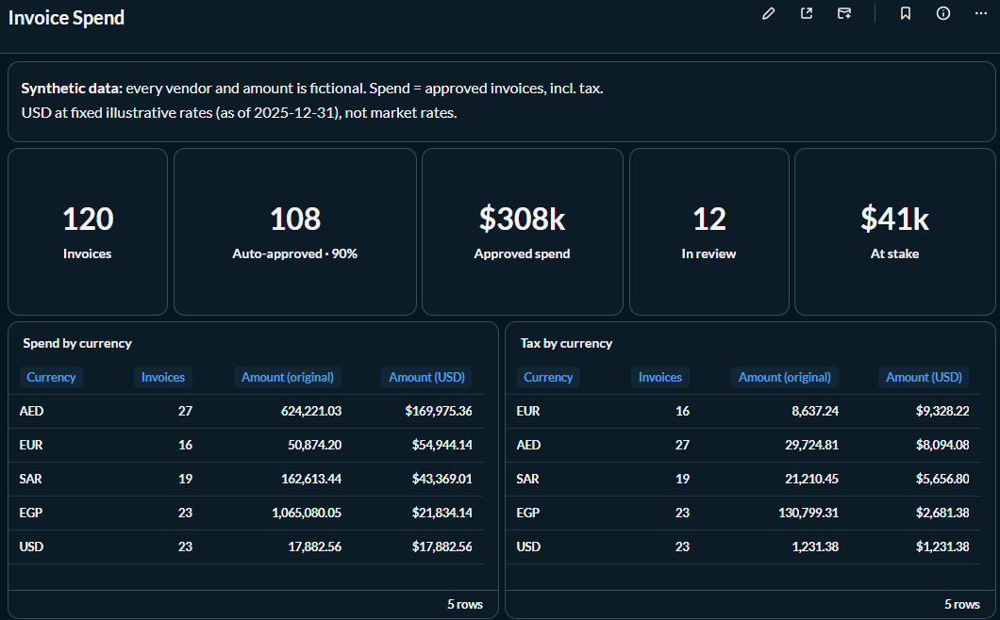
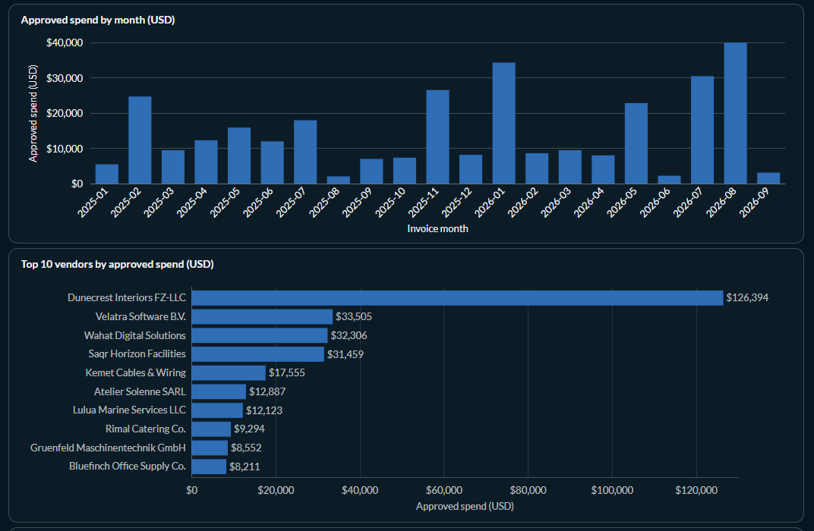
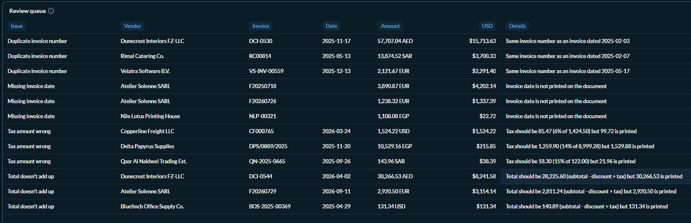
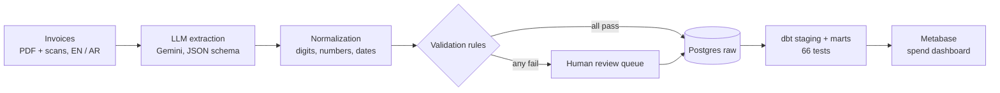
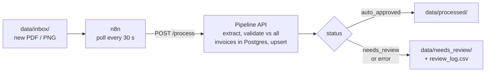
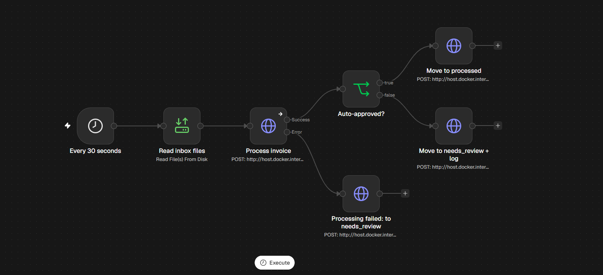

# AI Invoice & Document Extraction

Invoices (PDFs and scans, English and Arabic) in, validated structured data and a spend dashboard out, with a human review queue for anything that fails a check.

> All data in this repository is **synthetic**. Every vendor, buyer, address, tax ID and invoice is generated by `src/generate_invoices.py` (seed 42). Any resemblance to real organisations is coincidental.

## Results

Measured against ground truth on 120 synthetic invoices: 120 PDFs plus 36 degraded scans of the same invoices (156 files), model `gemini-3.5-flash-lite`.

| Metric | Result |
|---|---|
| Field accuracy, PDFs | 100% (3,876/3,876) |
| Field accuracy, scans | 99.8% (1,114/1,116) |
| Deliberate anomalies sent to review | 12/12 invoices (15/15 files incl. scans) |
| False alarms (correct invoices sent to review) | 0 of 140 |
| Auto-approved | 90% (141 of 156 files) |
| Cost per 1,000 invoices | $1.67 (Standard), $0.84 (Batch API) |
| Average latency | 3.64 s per invoice (p95 11.90 s) |

Field accuracy is after one pipeline normalisation rule (discounts stored as positive amounts), applied to the stored model output with no re-run; before it, PDFs were 99.9%. Full method, per-field and per-template breakdowns, and the cost math: **[docs/accuracy_report.md](docs/accuracy_report.md)**.

These are clean, computer-generated invoices. Real-world accuracy will be lower, which is why every document goes through the validation rules.

## Dashboard


Headline numbers, plus spend and tax by currency in the original currency and in USD.


Approved spend by month and the top 10 vendors (vendor name variants merged in dbt).


Review queue: each flagged invoice with a plain-English issue, the amount at stake and the validator's reason.

## Architecture



Every invoice is loaded to Postgres with its status (`auto_approved` or `needs_review`) and the reasons it failed. Spend marts count approved invoices only; the review queue mart holds the rest.

## Automation (n8n)

Drop a PDF or PNG into `data/inbox/` and it is processed without running any script: an n8n workflow polls the folder every 30 seconds and calls a small local API (`src/api.py`, FastAPI) that runs the same extractor, normalisation, validation and loader as the batch pipeline.




The workflow in n8n: poll the inbox, process each file, then route it by status; API errors take their own path to review.

- **Checks against everything loaded.** For a single file, the duplicate and date-sequence rules compare it with every invoice already in Postgres, not just a batch. A re-sent file keeps its original place in the arrival order, so it is never a duplicate of itself.
- **One invoice at a time.** Loading upserts by `doc_id` (header, lines and review rows in one transaction); other invoices are untouched.
- **Secrets stay out of the workflow.** The API listens on 127.0.0.1 only and requires a bearer token from `.env`; in n8n the token is a Header Auth credential, so `n8n/workflows/invoice_pipeline.json` contains none.
- **Reasons a person can read.** The API and `review_log.csv` use the same wording as the dashboard, e.g. "Duplicate invoice number: Same invoice number as an invoice dated 2025-02-07", with no internal ids or field names.
- **Nothing loops.** A file the API cannot process (extraction error, quota, or not cached when `PIPELINE_CACHE_ONLY=1`) goes to `needs_review/` with the error as its reason instead of being retried every poll.

Setup and import steps: [n8n/README.md](n8n/README.md).

## What makes it reliable

- **Normalization.** Arabic-Indic digits, `1.234,56` vs `1,234.56`, and printed dates are converted to one form in code (`src/extract/normalize.py`). Money is `Decimal`, never float.
- **Validation rules.** Line totals, subtotal, tax, total (0.01 tolerance), required fields, due date after invoice date, no future dates, duplicate invoice numbers per vendor, and invoice-number/date order per vendor (`src/validate.py`).
- **Review queue.** Any failed rule sends the invoice to a person with every reason listed, and the amount at stake.
- **Reconciliation tests.** dbt checks that per-currency invoice counts and totals in the marts equal the raw tables, and that every invoice is either approved or in the review queue.
- **Cached runs.** Each extraction is cached by document and file type with a SHA-256 of the source, so re-running validation, reports, loads or a new normalisation rule makes no API calls. Rate limits get backoff; quota errors stop the run cleanly.
- **Provider-agnostic extractor.** One interface (`src/extract/base.py`); Gemini is implemented, Claude and OpenAI are stubs. Provider and model are set in `.env`.

## Arabic support

One of the five invoice layouts is bilingual Arabic/English, with Arabic vendor names, labels and line descriptions. About half of those invoices print amounts, quantities and dates in Arabic-Indic digits (`٠١٢٣٤٥٦٧٨٩`). Field accuracy on Arabic-Indic documents: 100% (464/464). Sample: [doc_0045.pdf](data/samples/doc_0045.pdf) with its [ground truth](data/samples/doc_0045.json).

More samples (one per layout, plus two scans): [data/samples/](data/samples/).

## Tech stack

Python 3.14, Gemini API (`google-genai`), Pydantic, ReportLab + Pillow (synthetic invoices and scans), PostgreSQL 16 (Docker), dbt-core + dbt-postgres, Metabase, FastAPI + uvicorn, n8n (Docker), pytest.

## Quick start

```bash
python3.14 -m venv .venv && source .venv/bin/activate
pip install -r requirements.txt
cp .env.example .env                     # set GEMINI_API_KEY and passwords

python src/generate_invoices.py          # 120 PDFs + 36 scans + ground truth, seed 42 (~15 s)
pytest -q                                # offline, no API calls

python src/run_extraction.py --input data/synthetic/pdf --delay 15
python src/run_extraction.py --input data/synthetic/scans --delay 15
python src/validate.py                   # review queue -> data/review/queue.csv
python src/report.py                     # -> docs/accuracy_report.md

docker compose up -d                     # Postgres as invoice_pg on 127.0.0.1:5434
python src/load.py
bash scripts/create_metabase_ro.sh       # read-only role for Metabase

python3.14 -m venv .venv-dbt && .venv-dbt/bin/pip install -r requirements-dbt.txt
set -a; source .env; set +a
(cd dbt && ../.venv-dbt/bin/dbt build --profiles-dir .)

python scripts/metabase/build_spend_dashboard.py   # needs a running Metabase at MB_URL and MB_API_KEY

python src/api.py                        # pipeline API on 127.0.0.1:8765 (needs PIPELINE_API_TOKEN)
docker compose up -d n8n                 # n8n on 127.0.0.1:5678, then import the workflow: n8n/README.md
```

Extraction works on the free tier of Google AI Studio (requests are spaced to stay under the rate limit). Details for every step: [docs/technical_notes.md](docs/technical_notes.md).

## Repository layout

```
src/                 generator, extraction runner, validate, report, load, pipeline API
src/extract/         extractor interface, Gemini implementation, schema, normalization
src/prompts/         versioned extraction prompt
dbt/                 seeds (vendor aliases, FX), staging, marts, reconciliation tests
scripts/             Metabase role and dashboard builder
n8n/                 folder-watch workflow (no credentials inside) and how to import it
data/samples/        committed example invoices with ground truth
data/synthetic/      ground truth + manifest (generated PDFs and scans are gitignored)
data/inbox/          drop files here for the n8n workflow; it moves them to data/processed/ or data/needs_review/
docs/                accuracy report, technical notes, screenshots
tests/               pytest suite
assets/fonts/        Amiri font (SIL Open Font License)
```

## Limitations and next steps

- **Synthetic data.** Five clean layouts and invented vendors. Real invoices (handwriting, stamps, multi-page tables, phone photos) will score lower; the numbers above are indicative.
- **One error got through.** On the scan `doc_0071.png` the printed `03/01/2026` (DD/MM) was read as 1 March instead of 3 January, for both invoice and due date. The swapped date still fell between the vendor's neighbouring invoices, so no rule fired ([details](docs/accuracy_report.md#2-review-queue)). Planned fix: learn each vendor's date format (DD/MM or MM/DD) from its unambiguous dates (day > 12) and flag or correct dates that contradict it.
- **New invoices don't re-check older ones.** A file dropped in the inbox is checked against every stored invoice, but stored invoices are not re-validated against it: if a new invoice shows that an older one was out of sequence, the older one keeps its status until the next batch `python src/load.py` (which re-validates everything, but replaces the tables from the extraction cache).
- **Simple automation.** The workflow polls every 30 seconds and the API processes one file at a time, which suits a single mailbox-sized inbox, not high volume. The API and n8n are local only (127.0.0.1); there is no user management beyond one shared token.
- **Next:** a model comparison with `gemini-3.8-flash` on the same dataset and report.

## Status

- [x] Synthetic dataset: 5 layouts incl. bilingual AR/EN, scans, anomalies, ground truth, tests
- [x] LLM extraction (Gemini, provider-agnostic interface): 120 PDFs + 36 scans
- [x] Validation rules, review queue, accuracy report
- [x] PostgreSQL load, dbt models (66 tests incl. reconciliation), Metabase spend dashboard
- [x] n8n folder-watch workflow and pipeline API (single-file checks against all stored invoices)
- [ ] Model comparison (`gemini-3.8-flash`)

## Licences

- Fonts: Amiri © The Amiri Project Authors, SIL Open Font License 1.1 ([assets/fonts/OFL.txt](assets/fonts/OFL.txt)).
